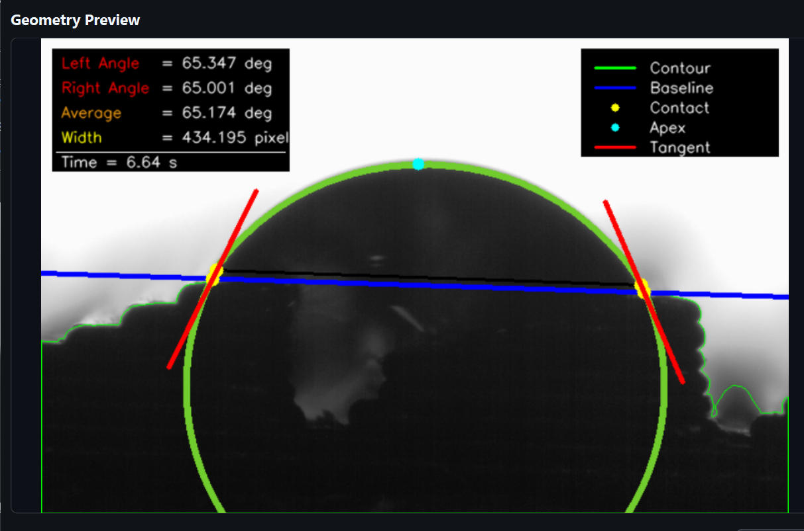
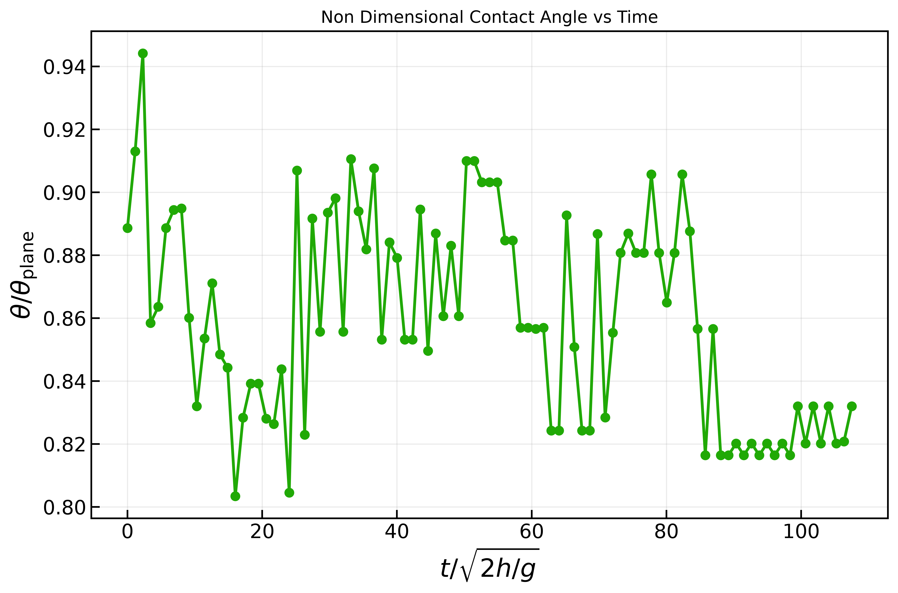
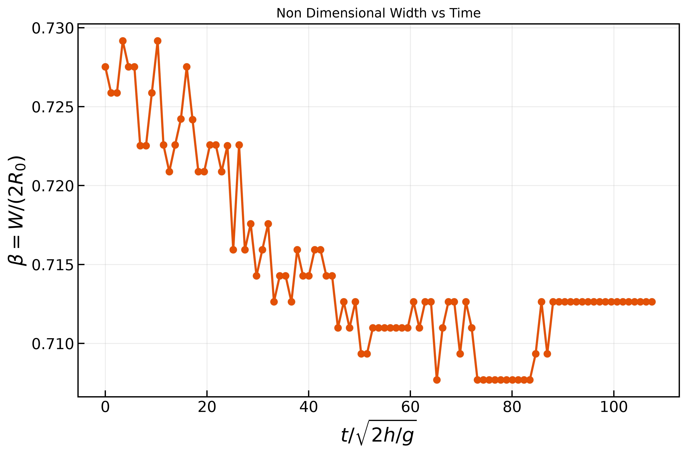
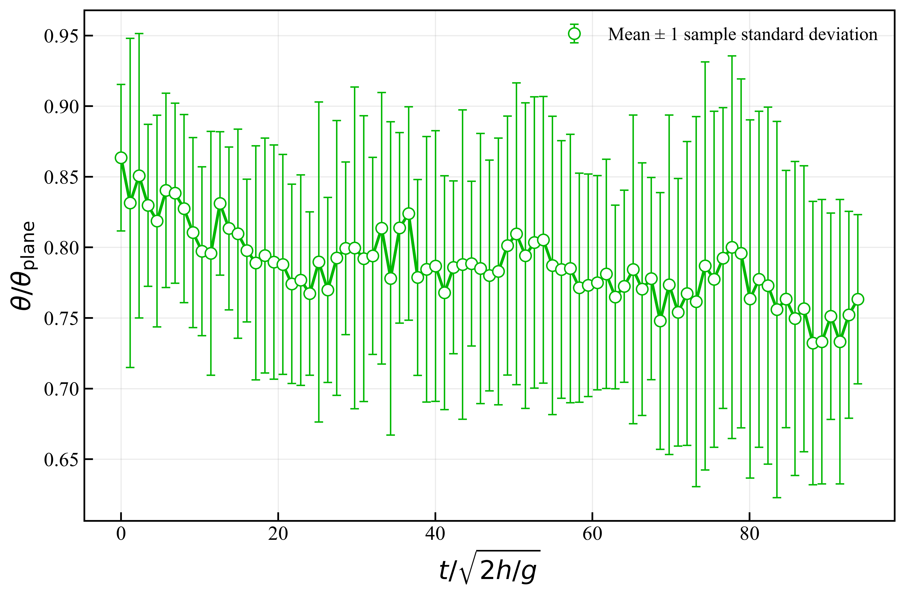
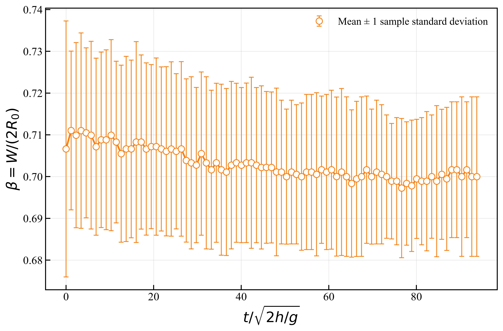

# Dynamic Contact Angle Analyzer — Version 2

A Windows desktop application for **dynamic contact-angle measurement and visualization using computer vision**. The application streamlines the experimental workflow, from loading a droplet video and inspecting its geometry to generating annotated videos, exporting measurements, and visualizing results through individual and mixed graphs.

**Version:** 2  
**Platform:** Windows  
**Author:** Mayukh Paul  
**Institution:** Indian Institute of Technology Kharagpur

---

## Overview

Contact angle is an important parameter for characterizing the interaction between a liquid droplet and a solid surface. Its evolution over time can provide insight into wetting dynamics, droplet spreading, and surface wettability.

Dynamic Contact Angle Analyzer provides a graphical workflow for processing experimental droplet videos, inspecting the measurement geometry, obtaining time-dependent contact-angle data, and visualizing experimental results.

Version 2 supports three experiment samples, independent processing workflows, video and CSV export, individual graphs, and mixed-graph comparisons.

## Key Features

- **Three-sample workflow:** Access and manage three experiment samples through one main window.
- **Independent experiment handling:** Keep each sample's video, processing workflow, and results separate.
- **Geometry preview:** Inspect the droplet and its geometric reference before full video processing.
- **Dynamic contact-angle analysis:** Obtain left, right, and average contact-angle measurements over time.
- **Processed video generation:** Review the analysis visually across video frames.
- **CSV export:** Save measurement data for plotting and further analysis.
- **Individual graph generation:** Visualize measurements for a particular experiment.
- **Mixed-graph generation:** Compare results from multiple experiments in combined visualizations.
- **Integrated graphical interface:** Perform the workflow through the application's pages and dialogs.

## Repository Structure

```text
Dynamic-Contact-Angle-Measurement/
├── README.md
├── Input/
│   ├── Sample 1.avi
│   ├── Sample 2.avi
│   └── Sample 3.avi
├── Output/
│   ├── Sample 1.gif
│   ├── Sample 2.gif
│   ├── Sample 3.gif
│   ├── Sample 1.csv
│   ├── Sample 2.csv
│   ├── Sample 3.csv
│   ├── contact_angle_sample_1.png
│   ├── width_sample_1.png
│   ├── mixed_contact_angle.png
│   ├── mixed_width.png
│   └── geometry_preview_sample_1.png
└── [application demonstration video — see note below]
```

The GIFs above are the GIF versions of the processed videos. Keep the converted GIFs in `Output/` and use the exact filenames shown here. The geometry preview filename is a suggested name: the supplied ZIP did **not** contain a geometry-preview image, so add that image to `Output/` or update the path below to its actual filename.

## Application Demonstration

### Processed video — Sample 1


### Geometry preview



### Individual graphs — Sample 1

**Contact angle vs. time**



**Width vs. time**



### Mixed graphs

**Mixed contact-angle graph**



**Mixed width graph**



### Processed videos — Samples 2 and 3


> **GitHub video-size note:** GitHub does not display MP4 files inline in a README like it displays GIFs. The GIFs are included here for convenient previews; the original processed MP4 files can be retained locally or attached to a GitHub Release if you want to distribute them.

## Complete Workflow

1. Select an experiment sample.
2. Load the corresponding input video.
3. Inspect the droplet and geometry preview.
4. Run the video-processing workflow.
5. Review the processed output.
6. Export the processed video and measurement CSV.
7. Configure and generate individual graphs.
8. Generate mixed graphs when comparing experiments.
9. Repeat for the remaining samples as required.

## Three-Experiment Workflow

The main window provides access to three experiment samples. Each sample has an independent working context so its video, processing workflow, and results can be handled separately.

The **Reset Video** control allows the current sample's video workflow to be restarted when another input needs to be selected or processed. After resetting, verify the selected video and geometry before proceeding.

## Input Video and Geometry Preview

Load the experimental recording containing the droplet and solid surface. Check that the intended video is selected before continuing.

Use the geometry preview to inspect a representative frame and the geometric reference used in the measurement. The baseline represents the solid surface against which contact angles are evaluated. Inspecting the geometry before processing helps confirm that the intended droplet and surface are being analysed.

## Video Processing

Once the video and geometry have been prepared, start processing for the selected sample. The application processes the recording to produce time-dependent measurements and visual output for review.

The analysis concerns the droplet profile and contact regions relative to the baseline. Depending on the output view, the processed visualization can include the droplet contour, contact points, local tangent construction, contact-angle annotations, and time information.

The application provides:

- **Left contact angle:** the angle evaluated at the left contact region.
- **Right contact angle:** the angle evaluated at the right contact region.
- **Average contact angle:** the average of the left and right contact-angle measurements.

## Processed Output and Data Export

Use **Save Processed Video As** to save the processed, annotated video to a location and filename of your choice. Use **Save CSV As** to export measurement data for graph generation, data inspection, and further scientific analysis.

Keep each exported video and CSV clearly labelled and associated with the correct sample to avoid mixing experimental results.

## Individual Graph Generation

The individual-graph workflow visualizes measurements from a selected experiment. Select the intended data and available plotting options, generate the graph, and verify that it belongs to the correct sample and that the axes and plotted quantities are suitable for interpretation.

The repository currently includes the Sample 1 contact-angle and width graphs.

## Mixed Graph Generation

Mixed graphs support combined visualization of data from multiple experiments.

1. Open the mixed-graph option.
2. Select the experiment data and plotting options available in the dialog.
3. Review the selected inputs and configuration.
4. Generate the mixed graph.
5. Verify that the intended experiments and quantities are being compared.

Comparisons should use compatible quantities, units, and data selections. Clearly identifying each experiment helps make the results easier to interpret.

## Scientific Applications

Dynamic contact-angle measurements can support experimental studies involving:

- Surface wettability and wetting dynamics
- Droplet spreading and motion
- Surface engineering and coating characterization
- Materials science
- Microfluidics
- Heat-transfer and related interfacial phenomena

Interpretation should account for image quality, experimental conditions, the chosen geometric reference, and the limitations of the measurement setup.

## Demonstration Video

The full application demonstration video is approximately **1.48 GB**. Ordinary GitHub repository files are not suitable for files above 100 MB. Upload the video as an asset on a **GitHub Release** and link it here, or use Git LFS if you specifically need the video versioned with the repository.

Replace the link below once the video has been uploaded:

[Watch or download the full application demonstration video](REPLACE_WITH_GITHUB_RELEASE_ASSET_URL)

## Public Demonstration Repository

This repository is intended to demonstrate the application's workflow and representative outputs. It can contain the README, sample inputs, selected output media, CSVs, and graph images without publishing the implementation.

Before pushing changes, review the files staged for the Git commit. Do not commit application source code, backend executables, PyInstaller `.spec` files, Inno Setup `.iss` scripts, installers, credentials, tokens, or private experimental data unless you explicitly intend to publish them.

A README and demonstration media document how the application works; they do not host the Windows desktop application as an interactive web application.

## Author

**Mayukh Paul**  
Indian Institute of Technology Kharagpur

*Dynamic Contact Angle Analyzer — Version 2*
